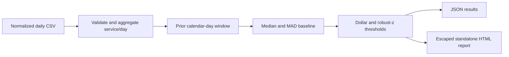

# Cloud Cost Anomaly Detector

Flag unusual daily cloud spend with an explainable statistical baseline and generate a shareable HTML review report. No credentials or paid services are required.

**Status:** runnable local portfolio project with synthetic AWS-style data and unit tests. It does not connect to billing APIs, change infrastructure, or claim real savings. This is statistical anomaly detection, not a trained machine-learning model.

## Quick start

Requires Python 3.11 or later; no external dependencies.

```bash
python detector.py samples/costs.csv --json report.json --html report.html
python -m unittest discover -s tests -v
```

Open `report.html` in a browser. The supplied data produces one EC2 alert on October 8, 2026: $125 against a $40 median baseline. All data is synthetic. The generated report includes normal and insufficient-history observations so the reviewer can see coverage.

## Detection logic

For each service and date, use only observed costs in the preceding seven calendar days:

1. Require seven history observations by default; missing days are not imputed as zero.
2. Compute the history median and median absolute deviation (MAD).
3. Compute `robust_z = 0.6745 × (cost − median) / MAD` when MAD is nonzero.
4. Flag an upward anomaly only when the increase is at least $10 and robust z is at least 3.5.
5. If MAD is zero, use the $10 increase threshold alone and report z as null.

This handles constant baselines without dividing by zero and avoids using future costs in a historical decision. Currency arithmetic and duplicate aggregation use Python Decimal. Only the displayed robust z score is converted to a float.



## Input contract

```csv
date,service,cost_usd
2026-10-01,Amazon EC2,40.00
```

Dates must use ISO `YYYY-MM-DD`. Costs must be finite, nonnegative USD values. Duplicate service/date rows are summed. Normalize billing exports into this schema first; raw AWS Cost and Usage Reports are not accepted directly. Credits, refunds, multiple currencies, account boundaries, and usage quantities are outside this contract.

## Configuration and automation

```bash
python detector.py samples/costs.csv --window 14 --min-history 7 \
  --min-increase 20 --z-threshold 4 --html report.html
python detector.py samples/costs.csv --fail-on-anomaly
```

Default exit code is 0 even when alerts exist. `--fail-on-anomaly` returns 1 when any alert exists; invalid input/configuration returns 2. A CI job can archive the generated HTML and JSON for human review. No automatic resource shutdown is performed.

## Limitations and next experiments

There is no weekly seasonality, multi-account grouping, backfill handling, or billing ingestion yet. Sustained anomalies enter future baselines and can become normal; missing dates lower coverage. A seven-day warmup is too short for many real workloads. Choose thresholds using labeled historical data and compare false positives and missed incidents before operational use.

Next experiments: collect read-only billing data, preserve account and currency dimensions, compare a weekday baseline, evaluate on labeled incidents, and notify a human reviewer. Add an ML model only if it improves a measured baseline.

## Interview walkthrough

Run the supplied report, explain the single EC2 alert, show how a missing day affects coverage, and explain why spend drops do not trigger upward alerts. Discuss the balance between sensitivity and alert fatigue. Do not claim savings or detection accuracy on real workloads without supporting measurements.
